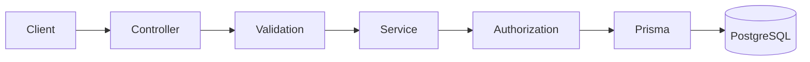

# Project Intent

## Purpose

This project is a learning-first backend application built with NestJS and
Prisma 8.

It has two equally important outcomes:

1. Build a complete, production-minded ticketing-system backend.
2. Help the user understand and implement the architecture themselves.

The finished code matters, but the learning process is not side content. An
agent speedrunning the entire backend would defeat the purpose of the project.

## Product

The application is a support-ticket API where:

- Users can create and view their own tickets.
- Users and administrators can exchange replies.
- Administrators can manage tickets and update their status.
- Authentication identifies the caller.
- Authorization protects private tickets and administrative actions.
- Data persists in a PostgreSQL database through Prisma 8.

The application should remain small enough to understand and finish. “Full
architecture” means covering the important backend responsibilities—not
summoning the enterprise final boss with unnecessary layers or microservices.

## Architecture Goal

The project should gradually demonstrate:

- Feature-based NestJS modules
- Controllers and HTTP boundaries
- Services and business rules
- Prisma 8 database integration
- Database contracts and migrations
- Request validation
- Authentication and session management
- Authorization and ownership checks
- Consistent application errors
- Configuration and environment variables
- Automated testing
- Application lifecycle and graceful shutdown
- Deployment and runtime verification

Add an abstraction when it has a clear responsibility. Do not introduce a
repository, interface, event bus, or other layer only because a diagram on the
internet said every backend needs one.

A typical request should remain traceable:

