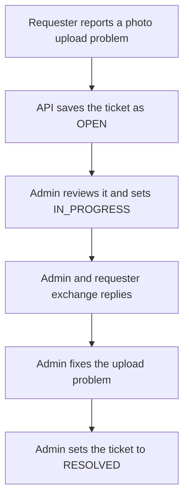
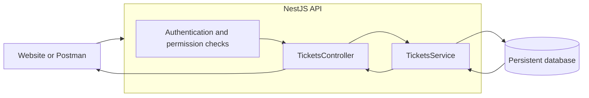
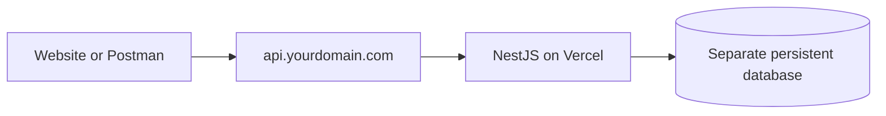

# Support ticket API

This project is a planned NestJS HTTP API for reporting problems, discussing them, and tracking their resolution. This README is a beginner guide to the proposed service. No application, database, authentication, or deployment has been implemented yet.

The first version will be one service with one persistent database. A website can call the API later. For now, the goal is small enough to finish without unlocking the enterprise final boss.

## What it does

Imagine a user cannot upload a photo to your website. They submit a ticket titled "Photo upload keeps failing" and describe the error. An admin reads the ticket, asks for details, and marks it resolved after fixing the problem.

The API stores that conversation and its status. It does not fix the upload itself.



This diagram shows a typical workflow, not a complete set of status transition rules.

## Who can use it

| Action | Requester | Admin |
| --- | --- | --- |
| Create a ticket | Yes, for themselves | Not part of the initial admin workflow |
| List and read tickets | Their own tickets only | All tickets |
| Add a reply | Their own tickets only | Any ticket |
| Change a ticket's status | No | Yes |

Authentication will identify the caller. Permission checks will decide which tickets that caller can access. The authentication mechanism has not been chosen yet.

The API must determine ticket ownership and reply authorship from the authenticated caller. A caller must not be able to claim another identity or grant themselves admin access through a request body. Knowing a ticket ID does not grant access to its contents.

## Tickets and replies

A ticket represents one reported problem.

| Information | Purpose |
| --- | --- |
| ID | Identifies the ticket, such as `42` |
| Subject | A short summary of the problem |
| Description | The requester's initial explanation |
| Requester | The identity that owns the ticket |
| Status | Tracks whether the problem is open, being handled, or resolved |
| Created at | Records when the ticket was submitted |

A reply belongs to a ticket and records its author, message, and creation time. Replies let the requester and admin continue the conversation without replacing the original description.

| Status | Meaning |
| --- | --- |
| `OPEN` | The ticket has been submitted and needs attention |
| `IN_PROGRESS` | An admin is working on the problem |
| `RESOLVED` | An admin considers the problem addressed |

New tickets start as `OPEN`. Only an admin can change the status. Reopening rules and whether resolved tickets accept further replies remain implementation decisions.

## How NestJS handles a request



`TicketsController` receives HTTP requests and passes the work to `TicketsService`. The service applies ticket rules and reads or writes records through the database integration. The controller returns a response to the caller.

Authentication checks identify the caller before protected operations run. Ticket ownership checks also need the service's knowledge of the requested record. NestJS modules will group the related controllers, services, and dependencies.

The database keeps tickets and replies across restarts and deployments. Its provider and the library used to access it are still undecided.

## Proposed endpoints

All endpoints below are planned and require an authenticated caller. `:id` means the ID of a specific ticket, such as `42`.

| Method | Path | Behavior |
| --- | --- | --- |
| `POST` | `/tickets` | Create a ticket for the requester with status `OPEN` |
| `GET` | `/tickets` | List the requester's own tickets, or all tickets for an admin |
| `GET` | `/tickets/:id` | Read an accessible ticket and its replies |
| `POST` | `/tickets/:id/replies` | Add a reply to an accessible ticket |
| `PATCH` | `/tickets/:id` | Change the ticket's status as an admin |

These examples illustrate the proposed JSON format. They are not responses from a running service or a finalized API contract. IDs and timestamps are sample values. Authentication headers will depend on the mechanism selected later.

### Create a ticket

```http
POST /tickets
Content-Type: application/json
```

```json
{
  "subject": "Photo upload keeps failing",
  "description": "I get an error when uploading a JPG."
}
```

An example response would be:

```json
{
  "id": 42,
  "subject": "Photo upload keeps failing",
  "description": "I get an error when uploading a JPG.",
  "status": "OPEN",
  "createdAt": "2026-09-05T06:00:00Z"
}
```

### List and read tickets

```http
GET /tickets
GET /tickets/42
```

These are two separate requests. The list request returns only records the caller may access. Reading ticket `42` returns its details and replies, provided it belongs to the requester or the caller is an admin.

An example ticket detail response would be:

```json
{
  "id": 42,
  "subject": "Photo upload keeps failing",
  "description": "I get an error when uploading a JPG.",
  "status": "OPEN",
  "createdAt": "2026-09-05T06:00:00Z",
  "replies": []
}
```

### Add a reply

An admin could ask for more information with this request. The requester can use the same endpoint to answer.

```http
POST /tickets/42/replies
Content-Type: application/json
```

```json
{
  "message": "What error message do you see when the upload fails?"
}
```

The API associates the reply with ticket `42` and the authenticated author.

### Change the status

After fixing the problem, an admin could send:

```http
PATCH /tickets/42
Content-Type: application/json
```

```json
{
  "status": "RESOLVED"
}
```

A requester must not be able to perform this action, even on their own ticket. For v1, this endpoint is intended for status changes only.

## Try the API before building a frontend

Once the service exists, Postman can send requests directly to it. Create a collection with a configurable base URL, then configure authentication after its mechanism is chosen.

Use two requester identities and one admin identity to check this flow:

1. Create a ticket as the first requester and confirm it starts as `OPEN`.
2. List tickets and read the new ticket as its requester.
3. Try listing, reading, and replying as the second requester. The first requester's ticket must stay private, and the reply must be rejected.
4. Read the ticket as an admin, set it to `IN_PROGRESS`, and add a reply.
5. Reply as the ticket's requester and check that both messages appear in its details.
6. Try changing its status as the requester. Confirm the API rejects the attempt.
7. Mark it `RESOLVED` as an admin and read it again to confirm the saved status.

Also check missing authentication, empty subjects or messages, unknown status values, and nonexistent ticket IDs. Invalid requests should fail without creating or changing records. Exact validation limits and error response formats will be defined during implementation.

After adding database persistence, verify that records survive an application restart. Repeat the core workflow against the deployed API before treating deployment as complete. A successful build alone does not prove the API works.

There are no runnable setup commands yet because this repository currently contains documentation only.

## Proposed hosting

Vercel is the proposed host. Its official NestJS integration deploys the application as a single Vercel Function. See [NestJS on Vercel](https://vercel.com/docs/frameworks/backend/nestjs) for the supported entrypoint and deployment instructions.



`api.yourdomain.com` is a placeholder for a subdomain you own, not a live address for this project. The deployment approach will be:

1. Implement the API and select its database provider and authentication mechanism.
2. Configure database credentials and authentication secrets through deployment environment variables.
3. Deploy the NestJS project to Vercel and verify the ticket workflow.
4. Add your API subdomain to the Vercel project and configure the DNS records Vercel requests. Follow [Vercel's custom domain guide](https://vercel.com/docs/domains/working-with-domains/add-a-domain).
5. Repeat the workflow through the custom domain and confirm records persist.

The design stores records in a separate persistent database. Application memory and deployment files are not the ticket store. No database or domain configuration has been created for this project.

## First version and later work

V1 covers tickets, replies, and statuses, with the authentication and permissions needed to keep conversations private. A submission form and admin inbox can follow once the API works.

Attachments, email notifications, live chat, and staff assignments are outside v1. Keep those side quests parked until the basic ticket flow is working.

Before implementation, choose the database provider, database access library, and authentication mechanism. Then settle validation limits, list pagination, error formats, and resolved-ticket behavior. This guide explains the project direction without pretending those decisions are already made.
